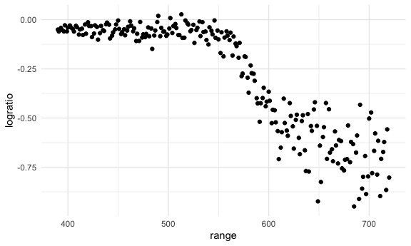
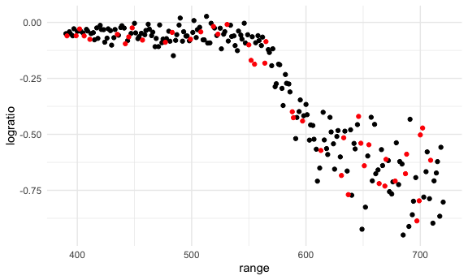
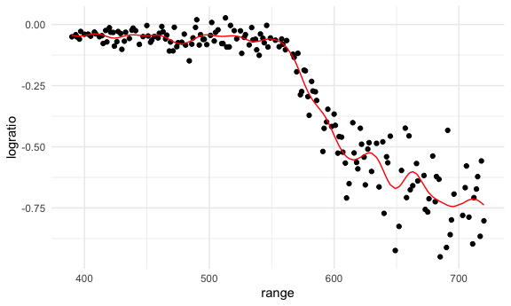
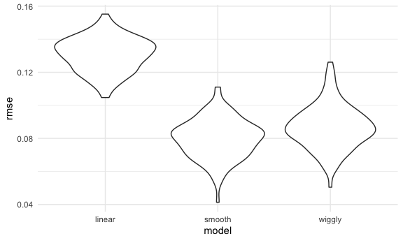

Cross Validation
================

``` r
library(tidyverse)
library(p8105.datasets)
library(modelr)
library(mgcv)
```

    ## Loading required package: nlme

    ## 
    ## Attaching package: 'nlme'

    ## The following object is masked from 'package:dplyr':
    ## 
    ##     collapse

    ## This is mgcv 1.9-5. For overview type '?mgcv'.

## LIDAR data

``` r
data("lidar")

lidar_df = 
  lidar |> 
  mutate(id = row_number()) |> 
  select(id, everything())

lidar_df |> 
  ggplot(aes(x = range, y = logratio)) + 
  geom_point()
```



Build my training and testing datasets.

``` r
train_df = sample_frac(lidar_df, size = .8)
test_df  = anti_join(lidar_df, train_df, by = "id")
```

``` r
ggplot(train_df, aes(x = range, y = logratio)) + 
  geom_point() + 
  geom_point(data = test_df, color = "red")
```



fit some models

``` r
linear_mod = lm(logratio ~ range, data = train_df)
smooth_mod = gam(logratio ~ s(range), data = train_df)
wiggly_mod = gam(logratio ~ s(range, k = 30), sp = 10e-6, data = train_df)
```

make a plot

``` r
train_df |> 
  add_predictions(wiggly_mod) |> 
  ggplot(aes(x = range, y = logratio)) + 
  geom_point() + 
  geom_line(aes(y = pred), color = "red")
```



do a model comparison!

``` r
rmse(linear_mod, test_df)
```

    ## [1] 0.13222

``` r
rmse(smooth_mod, test_df)
```

    ## [1] 0.08631311

``` r
rmse(wiggly_mod, test_df)
```

    ## [1] 0.09691987

## Repeat a bunch of times

Use some nice tools

``` r
cv_df = 
  crossv_mc(lidar_df, 100)

cv_df |>  pull(train) |> nth(3) |> as_tibble()
```

    ## # A tibble: 176 × 3
    ##       id range logratio
    ##    <int> <dbl>    <dbl>
    ##  1     3   393  -0.0419
    ##  2     4   394  -0.0510
    ##  3     5   396  -0.0599
    ##  4     7   399  -0.0596
    ##  5     8   400  -0.0399
    ##  6     9   402  -0.0294
    ##  7    11   405  -0.0476
    ##  8    12   406  -0.0604
    ##  9    13   408  -0.0312
    ## 10    14   409  -0.0382
    ## # ℹ 166 more rows

``` r
cv_df = 
  crossv_mc(lidar_df, 100) |> 
  mutate(
    train = map(train, as_tibble),
    test = map(test, as_tibble)
  )
```

let’s fit models and get rmses for these.

``` r
rmse_comp = function(model, dataset) {
  
  rmse(model, dataset)
  
}
```

``` r
cv_df = 
  cv_df |> 
  mutate(
    linear_fit = map(train, \(df) lm(logratio ~ range, data = df)),
    smooth_fit = map(train, \(df) gam(logratio ~ s(range), data = df)),
    wiggly_fit = map(train, \(df) gam(logratio ~ s(range, k = 30), sp = 10e-6, data = df))
  ) |> 
  mutate(
    rmse_linear = map2_dbl(linear_fit, test, rmse),
    rmse_smooth = map2_dbl(smooth_fit, test, rmse),
    rmse_wiggly = map2_dbl(wiggly_fit, test, rmse)
  )
```

Look at this!!

``` r
cv_df |> 
  select(starts_with("rmse_")) |> 
  pivot_longer(
    everything(),
    names_to = "model",
    names_prefix = "rmse_",
    values_to = "rmse"
  ) |> 
  ggplot(aes(x = model, y = rmse)) + 
  geom_violin()
```


