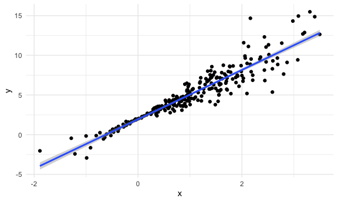
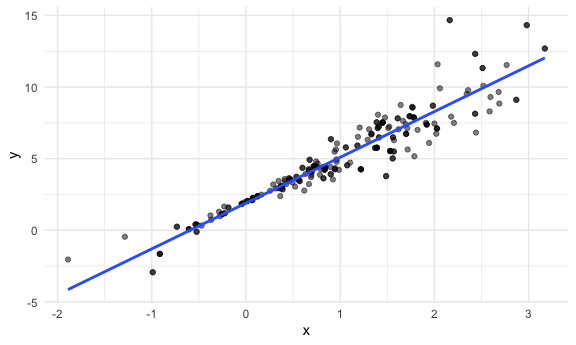
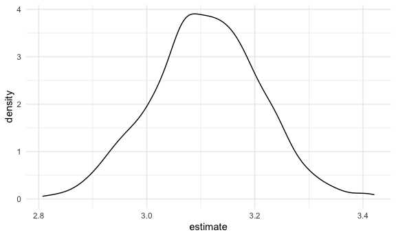
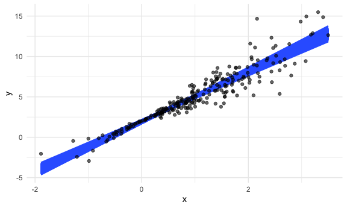
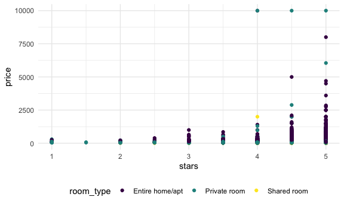
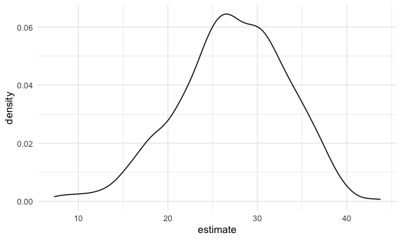

Bootstrapping
================

``` r
library(tidyverse)
library(p8105.datasets)
library(modelr)
library(mgcv)
```

    ## Loading required package: nlme

    ## 
    ## Attaching package: 'nlme'

    ## The following object is masked from 'package:dplyr':
    ## 
    ##     collapse

    ## This is mgcv 1.9-5. For overview type '?mgcv'.

``` r
set.seed(1)
```

## Simulated regression

``` r
n_samp = 250

sim_df_const = 
  tibble(
    x = rnorm(n_samp, 1, 1),
    error = rnorm(n_samp, 0, 1),
    y = 2 + 3 * x + error
  )
  
sim_df_nonconst = 
  sim_df_const |> 
  mutate(
    error = error * .75 * x, 
    y = 2 + 3 * x + error
  )
```

Plot some data

``` r
sim_df_nonconst |> 
  ggplot(aes(x = x, y = y)) + 
  geom_point() + 
  geom_smooth(method = "lm")
```

    ## `geom_smooth()` using formula = 'y ~ x'



Fit the regressions

``` r
sim_df_const |> 
  lm(y ~ x, data = _) |> 
  broom::tidy() |> 
  knitr::kable(digits = 3)
```

| term        | estimate | std.error | statistic | p.value |
|:------------|---------:|----------:|----------:|--------:|
| (Intercept) |    1.977 |     0.098 |    20.157 |       0 |
| x           |    3.045 |     0.070 |    43.537 |       0 |

Nonconstant

``` r
sim_df_nonconst |> 
  lm(y ~ x, data = _) |> 
  broom::tidy() |> 
  knitr::kable(digits = 3)
```

| term        | estimate | std.error | statistic | p.value |
|:------------|---------:|----------:|----------:|--------:|
| (Intercept) |    1.934 |     0.105 |    18.456 |       0 |
| x           |    3.112 |     0.075 |    41.661 |       0 |

## Draw a bootstrap sample

let’s always write a little function

``` r
draw_boot_sample = function(df) {
  
  sample_frac(df, replace = TRUE)
  
}
```

Does this work

``` r
sim_df_nonconst |> 
  draw_boot_sample() |> 
  ggplot(aes(x = x, y = y)) + 
  geom_point(alpha = .5) + 
  geom_smooth(method = "lm", se = FALSE)
```

    ## `geom_smooth()` using formula = 'y ~ x'



Draw a bunch of samples and analyze.

``` r
boot_strap_df = 
  tibble(
    strap_number = 1:1000
  ) |> 
  mutate(
    strap_sample = map(strap_number, \(i) draw_boot_sample(sim_df_nonconst)),
    model_fit = map(strap_sample, \(df) lm(y ~ x, data = df)),
    results = map(model_fit, broom::tidy)
  ) 
```

did this work??

``` r
boot_strap_df |> 
  select(strap_number, results) |> 
  unnest(results) |> 
  group_by(term) |> 
  summarize(
    mean_est = mean(estimate),
    se_est = sd(estimate)
  )
```

    ## # A tibble: 2 × 3
    ##   term        mean_est se_est
    ##   <chr>          <dbl>  <dbl>
    ## 1 (Intercept)     1.93 0.0747
    ## 2 x               3.11 0.101

``` r
boot_strap_df |> 
  select(strap_number, results) |> 
  unnest(results) |> 
  filter(term == "x") |> 
  ggplot(aes(x = estimate)) + 
  geom_density()
```



look at the results more

``` r
boot_strap_df |> 
  select(strap_number, strap_sample) |> 
  unnest(strap_sample) |> 
  ggplot(aes(x = x, y = y, group = strap_number)) + 
  geom_smooth(method = "lm", se = FALSE, alpha = .3) +
  geom_point(data = sim_df_nonconst, aes(group = NULL), alpha = .6)
```

    ## `geom_smooth()` using formula = 'y ~ x'



Quick notes.

``` r
boot_straps = 
  sim_df_nonconst |> 
  modelr::bootstrap(n = 1000)
```

## Airbnb

``` r
data("nyc_airbnb")

nyc_airbnb = 
  nyc_airbnb |> 
  mutate(stars = review_scores_location / 2) |> 
  rename(
    borough = neighbourhood_group,
    neighborhood = neighbourhood) |> 
  filter(borough != "Staten Island") |> 
  drop_na(price, stars) |> 
  select(price, stars, borough, neighborhood, room_type)
```

This doesn’t look good ..

``` r
nyc_airbnb |> 
  ggplot(aes(x = stars, y = price, color = room_type)) + 
  geom_point()
```



Boot strap!!

``` r
airbnb_bootstrap_df = 
  nyc_airbnb |> 
  filter(borough == "Manhattan") |> 
  modelr::bootstrap(n = 1000) |> 
  mutate(
    model_fits = map(strap, \(df) lm(price ~ stars + room_type, data = df)),
    results = map(model_fits, broom::tidy)
  )
```

are these coefficients close enough to Normal that I can trust default
inference?

``` r
airbnb_bootstrap_df |> 
  select(results) |> 
  unnest(results) |> 
  filter(term == "stars") |>  
  ggplot(aes(x = estimate)) + 
  geom_density()
```



CI for stars slope

``` r
airbnb_bootstrap_df |> 
  select(results) |> 
  unnest(results) |> 
  filter(term == "stars") |> 
  summarize(
    slope_estimate = mean(estimate),
    ci_lb = quantile(estimate, 0.025),
    ci_ub = quantile(estimate, 0.975)
  )
```

    ## # A tibble: 1 × 3
    ##   slope_estimate ci_lb ci_ub
    ##            <dbl> <dbl> <dbl>
    ## 1           27.2  14.9  37.6
